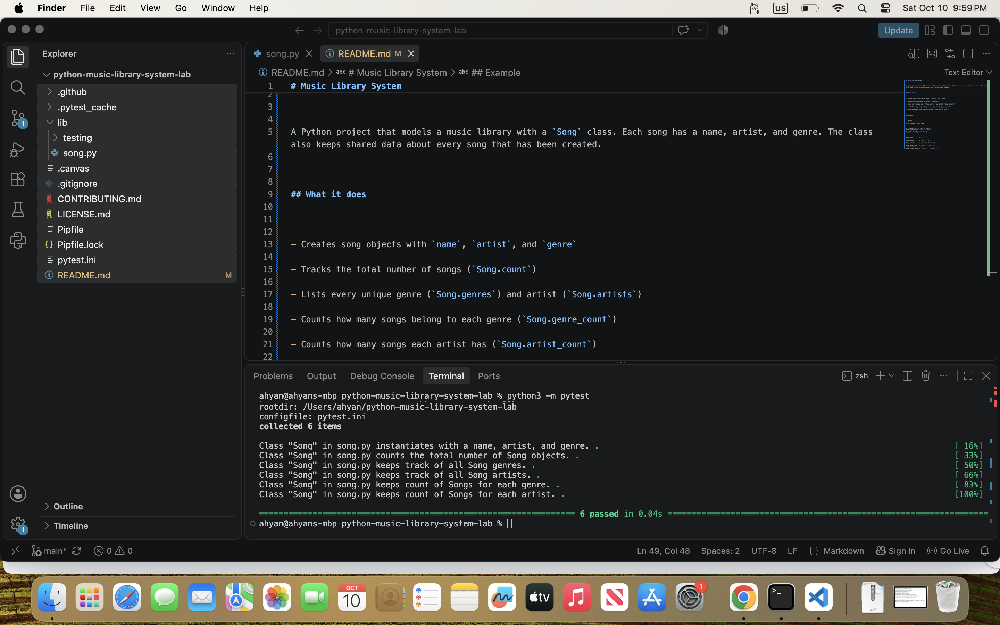

# Music Library System


A Python project that models a music library with a `Song` class. Each song has a name, artist, and genre. The class also keeps shared data about every song that has been created.


## What it does


- Creates song objects with `name`, `artist`, and `genre`

- Tracks the total number of songs (`Song.count`)

- Lists every unique genre (`Song.genres`) and artist (`Song.artists`)

- Counts how many songs belong to each genre (`Song.genre_count`)

- Counts how many songs each artist has (`Song.artist_count`)


## Example


```python

from lib.song import Song


Song("99 Problems", "Jay-Z", "Rap")

Song("Halo", "Beyonce", "Pop")


Song.count         # 2

Song.genres        # ["Rap", "Pop"]

Song.artists       # ["Jay-Z", "Beyonce"]

Song.genre_count   # {"Rap": 1, "Pop": 1}

Song.artist_count  # {"Jay-Z": 1, "Beyonce": 1}

## Test results
